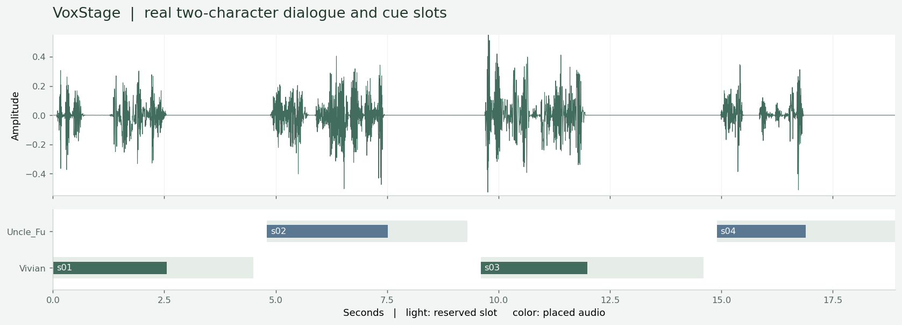

# VoxStage

**面向游戏与动画的可控对白制作 Agent**

[](https://github.com/l422145205-source/voxstage/actions/workflows/ci.yml)


给角色绑定音色，为每句台词设置表演方向与时间槽，生成后用独立 ASR 核对内容，再处理超时长或未通过检查的候选。修改一句台词时，其余声音可以复用，最终导出带来源记录的对白 WAV、SRT 与时间轴 JSON。

项目面向游戏剧情、动画短片与内容创作的对白资产工作流。它是**单机工程原型**，已完成真实本地模型运行，没有企业上线、模型微调或商业收益数据。



## 先听实际生成的对白

- [星港撤离：中文双角色对白](examples/saved/spaceport-ae0d9eeccdd40041/export/dialogue.wav)
- [Clockwork Gate：英文双角色对白](examples/saved/clockwork-29983bda49e460a8/export/dialogue.wav)
- [对应脚本与表演方向](examples/spaceport.json)

脚本为原创，声音来自 Qwen3-TTS 的公开预设音色，不使用真人录音或用户声纹。语气字段是生成指令，项目没有独立测量情绪控制准确率。[模型与依赖来源](THIRD_PARTY.md)。

## 实现重点

**受约束的对白 IR。** `Scene / Character / Cue / Policy` 描述台词原文、发音文本、角色绑定、非重叠时间槽、语气和尝试预算。台词原文、角色绑定与时间槽在控制器中保持固定，模型负责生成声音。可显式配置 `protected_terms`，避免低 CER 掩盖指定否定词或关键术语缺失。

**生成与验证分离。** Qwen3-TTS-12Hz-1.7B-CustomVoice 负责合成；Qwen3-ASR-0.6B 只接收音频与语言，`context` 固定为空，不提供参考台词。逐句记录字符编辑距离、音频能量、削波比例与时长；有限加速后的音频再次核对。ASR 是内容一致性的代理检查，不是人工正确答案。

**有界 Observe–Repair 循环。** 按失败原因选择接受、清晰重读、加快语速或拒绝；每句最多 1–3 次合成。仅在允许范围内使用 FFmpeg `atempo` 做保音高加速；超过边界则重生成或转人工复核，不截掉台词来满足时长。

**增量执行与来源追溯。** 生成参数、模型版本和种子形成内容指纹，原始音频按 SHA256 复核；ASR 缓存绑定音频哈希。修改一句台词只触发对应声音重建。OS 文件锁避免同一资产被并行写入，原子 JSON 保存阶段记录；缓存损坏时重新合成。

**隔离模型环境。** 官方 TTS 与 ASR 包分别依赖 Transformers 4.57.3 与 4.57.6，通过独立进程和带请求 ID 的 JSON Lines 协议通信，控制器不导入两个模型包。具有加载握手、响应 ID 核查、串行调用和超时终止。

## 无需 GPU：打开真实结果回放

Python 3.11+，在仓库根目录执行：

```bash
python -m venv .venv
# Linux/macOS: source .venv/bin/activate
# Windows PowerShell: .venv\Scripts\Activate.ps1
python -m pip install -e '.[dev]'
voxstage serve
```

打开 <http://127.0.0.1:8877>。可试听中英文成片、逐句候选及有意设置的不可满足时间槽，查看真实识别文本和失败原因。回放模式不会启动模型，也不会把预计算声音伪装成新生成。

## 启用本地模型制作

实测环境：Windows、Python 3.13.9、PyTorch/Torchaudio 2.11.0、RTX 5070 Ti Laptop 12 GB。TTS 与 ASR 固定 revision，模型文件共约 6.4 GB，下载脚本校验大小与 SHA256。完整权重、依赖安装目录和本地任务日志不进入 Git。

推荐为两个 worker 建立独立 Python 环境，在各环境按 [PyTorch 官方安装说明](https://pytorch.org/get-started/locally/)安装适合显卡的 CUDA 版本，然后安装各自依赖：

```bash
python -m venv runtime/venvs/tts
python -m venv runtime/venvs/asr
# Linux/macOS
runtime/venvs/tts/bin/python -m pip install -r requirements-tts.txt
runtime/venvs/asr/bin/python -m pip install -r requirements-asr.txt
# Windows 将 bin/python 替换为 Scripts/python.exe
```

worker 自动优先使用这些环境；如未建立，则使用控制器的 Python 和项目内 `runtime/deps/tts`、`asr`、`common` 导入目录。本机实测使用后一种隔离导入方式，并非声称所有全新环境都已测试。

```bash
# 默认使用已实测的官方 ModelScope 源，与 models.lock.json 的 revision 对应。
# 不同模型平台的 revision 不可混用；切换源需另行核验并更新锁文件。
python scripts/bootstrap.py model tts
python scripts/bootstrap.py model asr
voxstage serve --models
```

也可直接运行 `voxstage run examples/spaceport.json`。`--root` 默认为当前仓库目录。没有偷偷调用收费 API，也不需要启动 Ollama。

## 实验结果

16 条原创中英文脚本探针，在首次推理前冻结文本、分组和检查阈值：8 条开发组、8 条按不同场景分组的保留组。每句最多两次合成，最大允许 1.15 倍加速；以下“通过”指满足配置的 ASR、能量、削波与时间约束。

| 策略 | 开发组 | 保留组 | 合计 |
|---|---:|---:|---:|
| 首次生成，不适配时长 | 6/8 | 6/8 | 12/16 |
| 首次生成 + 有限时长适配 | 8/8 | 7/8 | 15/16 |
| 有限时长适配 + 有界重生成 | 8/8 | 8/8 | 16/16 |

使用 17 次真实合成完成这 16 条探针。其中一个英文候选为 7.52 秒，超过 4.5 秒时间槽；加入更快语速指令重生成后为 3.04 秒。三个其他候选使用约 1.052–1.062 倍加速后通过再次核对。

四句中文场景的初次制作为 4 次合成，完整重跑新增合成/ASR 均为 0；改一句台词只新增 1 次合成、复用 3 句。前端另一次真实单句修改也验证了相同调用行为。

这些样本少且为原创短句；没有人工 MOS、情绪评分或独立人工转写。检查阈值默认允许 CER ≤ 0.15，**通过不代表逐字正确**。例如一个保留样本的 ASR 将 “promised” 识别为 “promise”，仍在阈值内。不能将表格改写成线上准确率、自然度或音色一致性成绩。

[完整实验与失败分析](docs/experiments.md) · [冻结协议](reports/protocol_freeze.json) · [真实模型结果](reports/production_pilot.json) · [最终约束重放](reports/final_constraints_replay.json)

可用 `python -m pip install -e '.[plots]'` 安装波形绘图的可选依赖，再运行 `python scripts/render_waveform.py`。

## 验证与边界

`pytest` 覆盖对白契约、关键字保护、真实 WAV 与 FFmpeg 保音高变速、采样点边界、缓存增量重建/损坏修复、OS 锁和 API Range。43 项本地 CPU 测试通过；Linux Python 3.11/3.12 自动执行同一套测试，实际状态见 Actions。

当前 Agent 是确定性、受预算约束的制作工作流，基础模型负责语音生成与识别；没有通用 LLM 自由规划、强化学习或配音模型微调。角色使用固定预设音色，未评测说话人相似度。字幕为句级时间轴，不是音素对齐或口型生成。RMS/采样峰值检查不是 EBU R128 综合响度认证。服务仅监听本机，不提供多用户鉴权或公网部署。

## 进一步阅读

- [技术架构与取舍](docs/architecture.md)
- [实验设计与失败案例](docs/experiments.md)
- [简历条目与面试讲解](docs/resume-and-interview.md)
- [模型与第三方来源](THIRD_PARTY.md)

代码由 AI 编程工具辅助实现。公开结果来自真实本地推理；CPU 测试中的合成波形/识别替身仅用于测试，标记为 `synthetic-test-double`，不计入模型实验。
