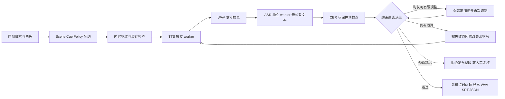

# 技术架构与设计取舍

VoxStage 的输入是结构化对白，输出是可追溯的声音资产。制作循环不允许自动改写台词来降低错误率；发音文本若与展示文本不同，必须显式登记在 `speech_text`。

## 契约边界

角色 ID、预设音色、台词、时间槽、语气与策略分别建模。校验唯一 ID、角色引用、有限数值、排序、非重叠及最大尝试次数。即使调用者传入已经实例化、随后被修改的 Pydantic 对象，执行前也重新序列化校验。

`protected_terms` 由脚本作者明确指定，必须存在于发音文本。对比使用 Unicode NFKC、大小写折叠和标点/空格忽略，不删除否定词或数值。保护词比平均 CER 更严格，但文字形式变体可能产生误报。它不能识别所有语义错误。

## 模型与进程协议

TTS/ASR 官方 Python 包固定不同 Transformers 版本，因此通过两个子进程隔离。模型只从本地已下载路径加载。标准输出保留给 JSON Lines，第三方日志重定向到标准错误；协议包含版本、加载握手和请求 ID。调用具有超时，超时后终止该 worker，而不是无限等待。

控制器单个 GPU 作业串行运行。TTS 与 ASR 可以驻留同一显卡，但不并发推理；这不是跨机器 GPU 调度系统。本机测试为 12 GB 显存，并未测量所有输入长度的显存峰值。

ASR 只接收音频与语言，并把 context 固定为空。它是独立任务检查点，仍属于 Qwen 模型家族，不能排除共享训练数据或系统性偏差。CER 阈值通过只意味着自动检查通过。

## 时间槽与媒体执行

时间槽是上限，短句末尾保留间隔。超长句仅在配置上限内使用 `atempo`，不改变音调以简单重采样凑时长，不通过截断声音满足约束。变换后重新识别，并按采样点检查输出不得侵入下句时间槽。

最终音轨是 24 kHz、单声道 PCM16。整段统一限制增益以避免采样峰值越界，保持各句相对电平；未声称达到广播综合响度标准。字幕只使用已放置音频的句级起止位置。

## 增量执行与恢复

原始声音的指纹包含台词发音文本、语言、预设音色、语气指令、种子和完整模型配置。ASR 指纹包含音频 SHA256、语言与模型配置。时间槽变化可复用原始声音，再重新适配和检查；文字或音色变化会导致相应音频缓存失效。当前使用完整后端身份做保守失效，尚未细分所有模型依赖的最小失效边界。

缓存复用前核查音频哈希。OS advisory lock 保护同一场景或缓存资产，异常退出时由操作系统释放；不凭时间戳删除其他 worker 的锁。JSON 以临时文件、flush/fsync 与 replace 保存。它支持已完成声音资产的安全复用，不提供分布式 exactly-once。

如果重新检查未通过，API 拒绝返回旧成片；已发布 WAV 被修改时也会因哈希不符而拒绝导出。

## 模块与个人实现范围

| 模块 | 内容 |
|---|---|
| contracts.py | 对白、角色、时间槽与策略 IR |
| director.py | 分析、分类、有限重试、候选接受与拒绝 |
| audio.py / text.py | 音频检查、保音高适配、CER、时间轴导出 |
| workers.py / model_worker.py | 依赖隔离、模型协议、生命周期与超时 |
| store.py | 内容指纹、原子记录与 OS 锁 |
| api.py / static | 制作、回放、试听与逐句检查工作台 |

基础模型与音频 codec 来自公开检查点；项目贡献在约束编译、独立核验、增量执行、模型隔离与可复现实验，而不是重新训练这些模型。
